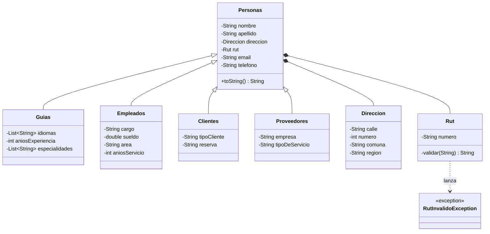

<div align="center">
🌋 Llanquihue Tour
Sistema de gestión para una agencia de turismo del sur de Chile
Aventura entre volcanes y lagos del Sur 🌊


</div>
---
📑 Contenido
Descripción
Conceptos aplicados
Estructura del proyecto
Diagrama de clases
Validaciones
Cómo ejecutar
Salida de ejemplo
Mejoras futuras
Autora
---
📋 Descripción
Llanquihue Tour modela las personas que interactúan con una agencia de turismo: guías, empleados, clientes y proveedores. Todas heredan los datos comunes de la clase `Personas` y agregan sus atributos propios.
Los datos se validan en los setters y el RUT chileno se valida y normaliza al momento de crearse.
---
🧠 Conceptos aplicados
Concepto	Dónde se aplica
🧬 Herencia	`Guias`, `Empleados`, `Clientes` y `Proveedores` extienden `Personas`
🧱 Composición	`Personas` contiene un objeto `Direccion` y un objeto `Rut`
🔒 Encapsulamiento	Atributos `private` con getters y setters
✅ Validaciones	Reglas en los setters con `IllegalArgumentException`
⚠️ Excepciones personalizadas	`RutInvalidoException` para RUT con formato inválido
📝 Text blocks	`toString()` multilínea con `"""` y `.formatted()`
---
🗂️ Estructura del proyecto
```text
repo-Llanquihue-Tour/
├── 📁 src/
│   ├── 📁 app/
│   │   └── Main.java                  → Punto de entrada
│   ├── 📁 model/
│   │   ├── Personas.java              → Clase base con datos personales
│   │   ├── Guias.java                 → Idiomas, experiencia, especialidades
│   │   ├── Empleados.java             → Cargo, sueldo, área, años de servicio
│   │   ├── Clientes.java              → Tipo de cliente y reserva
│   │   ├── Proveedores.java           → Empresa y tipo de servicio
│   │   ├── Direccion.java             → Calle, número, comuna y región
│   │   └── Rut.java                   → RUT validado y normalizado
│   └── 📁 util/
│       └── RutInvalidoException.java  → Excepción personalizada
└── Llanquihue_Tour.iml
```
---
🧩 Diagrama de clases

---
✅ Validaciones
Clase	Atributo	Regla
`Personas`	`nombre`, `apellido`	No pueden ser nulos ni vacíos
`Personas`	`email`	Debe contener `@`
`Direccion`	`comuna`	No puede ser nula ni vacía
`Direccion`	`numero`	Debe ser positivo
`Empleados`	`cargo`	No puede ser nulo ni vacío
`Empleados`	`sueldo`	Debe ser mayor a `0`
`Rut`	`numero`	Formato `XXXXXXXX-Y` → si no cumple lanza `RutInvalidoException`
> [!NOTE]
> El RUT acepta puntos (`19.994.040-4`): se eliminan automáticamente y la `k` se convierte a mayúscula.
---
🚀 Cómo ejecutar
> [!IMPORTANT]
> Requiere **JDK 15 o superior** por el uso de *text blocks*. El proyecto está configurado con **JDK 23**.
Opción 1 · IntelliJ IDEA
Clonar o abrir la carpeta del proyecto.
Ejecutar `src/app/Main.java` ▶️
Opción 2 · Terminal
```bash
git clone https://github.com/madsaldivia-dev/repo-Llanquihue-Tour.git
cd repo-Llanquihue-Tour
```
<details>
<summary>🐧 <b>Linux / macOS</b></summary>
```bash
javac -d out $(find src -name "*.java")
java -cp out app.Main
```
</details>
<details>
<summary>🪟 <b>Windows (PowerShell)</b></summary>
```powershell
javac -d out (Get-ChildItem -Recurse src -Filter *.java).FullName
java -cp out app.Main
```
</details>
---
🖥️ Salida de ejemplo
```text
╔══════════════════════════════════════════╗
║            LLANQUIHUE TOUR               ║
║  Aventura entre volcanes y lagos del Sur ║
╚══════════════════════════════════════════╝

========== GUÍA ==========
Nombre           : Juanito Perez
RUT              : 19994040-4
Email            : juanito@hotmail.cl
Teléfono         : 95678943
Dirección        : salvador Gutierrez 1234, Cerro Navia, Región Metropolitana
Idiomas          : Ingles, Español, Portugues
Años experiencia : 10
Especialidades   : Patrimonio Cultural, Tours de aventura, Montañismo
==========================
```
<details>
<summary>👀 <b>Ver salida completa (Empleado y Cliente)</b></summary>
```text
======== EMPLEADO ========
Nombre           : Patricia Saldivia
RUT              : 21337233-5
Email            : Patricia@hotmail.cl
Teléfono         : 956585202
Dirección        : Corral 1725, Pudahuel, Región Metropolitana
Cargo            : Jefa de cocina
Área             : Cocina
Sueldo           : $999555
Años de servicio : 8
==========================

======== CLIENTE =========
Nombre           : Noa Rosales
RUT              : 21869545-5
Email            : Noa@hotmail.cl
Teléfono         : 978334431
Dirección        : Rio de janeiro 1015, Renca, Región Metropolitana
Tipo             : PREMIUM
Reserva          : Tour Patagonia
==========================
```
</details>
---
🔮 Mejoras futuras
[ ] Validar el dígito verificador del RUT (algoritmo módulo 11)
[ ] Convertir `tipoCliente`, `reserva` y `area` en enums o clases propias
[ ] Formatear el `toString()` de `Proveedores` igual que el resto
[ ] Agregar pruebas unitarias con JUnit 5
[ ] Menú interactivo por consola para registrar personas
---
👩‍💻 Autora
<div align="center">
Madeleine Saldivia

⭐ Proyecto desarrollado como parte de la carrera de Analista Programador ⭐
</div>
